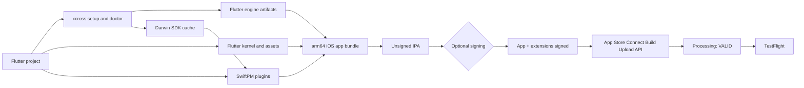
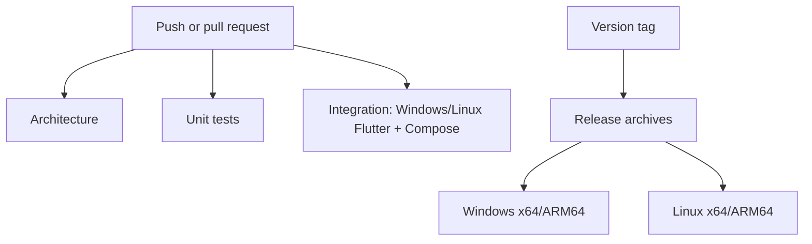

<div align="center">

# xcross Flutter Windows/Linux

Build and validate Flutter iOS applications from Windows or Linux with no
Mac, Xcode, WSL, Codemagic, or remote Mac runner.

[](https://github.com/Tuyose/xcross-flutter-windows-linux/actions/workflows/architecture.yml)
[](https://github.com/Tuyose/xcross-flutter-windows-linux/actions/workflows/unit-tests.yml)
[](https://github.com/Tuyose/xcross-flutter-windows-linux/actions/workflows/integration.yml)
[](https://github.com/Tuyose/xcross-flutter-windows-linux/releases)
[](#supported-hosts)
[](LICENSE)

**A reproducible, AI-friendly distribution of xcross focused on Flutter iOS builds,
SwiftPM plugins, Darwin SDK setup, CI validation, signing, and TestFlight handoff.**

[Quick start](#quick-start) · [What was achieved](#what-was-achieved) ·
[AI guide](docs/AI-QUICKSTART.md) · [TestFlight guide](docs/windows-testflight.md) ·
[Troubleshooting](#troubleshooting) · [Contributing](CONTRIBUTING.md)

</div>

---

## What this repository is

This is a community-maintained modified distribution based on
[arxdeus/xcross](https://github.com/arxdeus/xcross). The upstream project
already provides the core cross-platform Flutter/iOS toolchain. This repository
organises and documents the Windows/Linux Flutter path that was exercised with a
real plugin-heavy Flutter application and a real App Store Connect build.

The goal is simple: another developer should be able to give this README and
the [AI quick-start](docs/AI-QUICKSTART.md) to an AI coding agent, run the
checks in order, and return useful evidence instead of a vague “it failed”.

> This is not an official Apple, Flutter, or upstream xcross project. It is an
> AGPL-3.0 community fork. Keep the upstream notices and read [NOTICE.md](NOTICE.md).

## What was achieved

| Area | Result | Evidence |
| --- | --- | --- |
| Flutter on Windows | Release AOT, assets, native assets, app bundle and unsigned IPA | Windows integration workflow |
| Flutter on Linux | Same cross-build path validated on x64 and ARM64 hosts | Linux integration workflow |
| SwiftPM plugins | Plugin graphs compile against the assembled Darwin SDK | SwiftPM integration jobs |
| Darwin SDK | Xcode SDK extraction/cache path works without running Xcode | `darwin_sdk_kit` and cache workflow |
| Cross-platform CI | Architecture, unit, integration and release jobs pass on Windows/Linux | GitHub Actions |
| Windows ARM64 | Native host and Flutter build path validated | `windows-11-arm` jobs |
| Signing | Main app and embedded `.appex` extensions can be signed with separate profiles | Nofpad case study |
| TestFlight handoff | App Store Connect Build Upload API path reaches `VALID` | Nofpad build `1.0.1 (1795343628)` |
| Repeatability | Existing build uploads are detected instead of producing a misleading duplicate failure | idempotent TestFlight pipeline |

### The Nofpad case study

The implementation was proven with a Flutter application containing native
plugins and an embedded widget:

```text
Flutter application
├─ Flutter AOT + assets
├─ SwiftPM plugin graph
│  ├─ Firebase / cloud_firestore
│  ├─ audio_waveforms
│  └─ permission_handler_apple
├─ native frameworks and resources
├─ notepy.app
└─ PlugIns/nofpadWidgets.appex
```

The final signing checks reported:

```text
Apple binary preflight: missing LC_ENCRYPTION_INFO=0
Apple binary preflight: plist mismatches=0
Widget arm64=True
Main app signature: PASS
Widget signature: PASS
App Store Connect processing: VALID
```

The case study is evidence for the workflow, not a promise that every Flutter
plugin is automatically compatible. Native plugins still need to be tested on
the target project and device.

## Supported hosts

- Windows x64
- Windows ARM64
- Linux x64
- Linux ARM64

The iOS target is `arm64-apple-ios`. The host does not need macOS, Xcode, WSL,
Codemagic, or a remote Mac. You still need a legitimate Apple Developer account
for device signing and App Store Connect distribution.

## How the pipeline works



### Build stages and what they prove

1. **Doctor** — host tools, Flutter SDK, Swift, LLVM, linker and Darwin SDK
   paths are visible.
2. **Engine** — Flutter artifacts match the selected Flutter engine revision.
3. **Dart** — kernel, assets and release AOT output are produced.
4. **Native assets** — plugin build hooks produce the expected arm64 output.
5. **SwiftPM** — iOS plugin targets compile against the same SDK and toolset.
6. **Assembly** — frameworks, resources, entitlements and app metadata are
   placed in an iOS bundle.
7. **Signing** — the host app and every embedded extension use matching App IDs,
   certificates, provisioning profiles and entitlements.
8. **Upload** — the signed IPA is reserved, uploaded in Apple-provided
   operations, committed, and polled until processing completes.

## Quick start

### 1. Clone and inspect

```powershell
git clone https://github.com/Tuyose/xcross-flutter-windows-linux.git
cd xcross-flutter-windows-linux
```

On Linux:

```bash
git clone https://github.com/Tuyose/xcross-flutter-windows-linux.git
cd xcross-flutter-windows-linux
```

### 2. Install the host prerequisites

Use the setup path for your host and keep versions pinned for reproducible
results. Do not silently upgrade Flutter, Swift, LLVM or the Darwin SDK while
diagnosing a build.

```text
Flutter SDK  : use the project-compatible version
Dart         : supplied by that Flutter SDK
Swift        : 6.4 or newer, pinned per CI
LLVM         : a Darwin/Mach-O capable toolchain
Darwin SDK   : prepared through xcross, from a legally obtained Xcode archive
Apple account: required only for signing, device install or TestFlight
```

Run:

```powershell
xcross setup
xcross flutter doctor
xcross flutter precache --ios
```

Linux uses the same commands. If the executable is not on `PATH`, run the
bundled binary from the release archive or use `dart run` from the package.

### 3. Build an unsigned IPA

From a Flutter application directory:

```powershell
xcross flutter build --release --ipa
```

The output is an unsigned IPA suitable for structural inspection. It is not a
TestFlight artifact until it has valid Apple Distribution signatures.

### 4. Validate before signing

Check these before spending time on signing:

- app Bundle ID and every extension Bundle ID;
- arm64 device slice;
- `Info.plist` minimum OS and device family;
- embedded framework resources and privacy manifests;
- no loose dynamic libraries;
- no secrets inside the repository or IPA build scripts.

### 5. Test the app on a device

For development installation, use the xcross Apple ID/device flow documented in
the upstream command reference. For distribution, use the signing and
TestFlight guide below. Developer Mode and device pairing are separate from
App Store Connect distribution signing.

## Windows TestFlight guide

Read [docs/windows-testflight.md](docs/windows-testflight.md) for the complete
flow. The short version is:

```text
unsigned IPA
  → preflight
  → Apple Distribution certificate + app profile
  → extension certificate/profile/entitlements
  → signed IPA
  → POST /v1/buildUploads
  → uploadOperations binary upload
  → PATCH /v1/buildUploadFiles/{id}
  → processingState = VALID
  → TestFlight
```

Never commit any of these files:

```text
AuthKey_*.p8
*.p12 / *.pfx
private keys
*.mobileprovision
Apple signing certificates
Xcode.xip or a private Darwin SDK cache
```

Use environment variables or a local secret manager. For an extension, create
and configure a separate Bundle ID and provisioning profile; removing the
extension only hides a signing problem and is not a valid fix.

## AI-assisted usage

Give the agent [docs/AI-QUICKSTART.md](docs/AI-QUICKSTART.md) together with:

- the exact host OS and architecture;
- Flutter, Dart, Swift and LLVM versions;
- the command that failed;
- the complete first error and the last 100 log lines;
- whether the failure is build, signing, upload or device runtime.

Do not paste passwords, 2FA codes, `.p8` contents, private keys or provisioning
profiles. The guide tells the agent to preserve caches, avoid destructive clean
commands and make one small change at a time.

## Troubleshooting map

| Symptom | Start here | Do not do first |
| --- | --- | --- |
| `gen_snapshot` missing | Flutter SDK/engine version and `xcross flutter doctor` | Upgrade Flutter blindly |
| Swift module not found | Darwin SDK, Swift SDK and module search paths | Delete all caches |
| `hidden decl has no owning module` | Re-run with one SwiftPM job and inspect module cache | Change production code randomly |
| `Foundation is defined in both` | Clang module cache/toolset isolation | Mix toolchains |
| `error: \U used with no following hex digits` | Normalize generated resource bundle accessor paths | Edit production sources |
| Widget signing failure | Extension App ID, profile and entitlements | Remove the widget |
| App Store Connect 409 duplicate | Check existing build processing state; increment build number for a new upload | Retry the same build forever |
| IPA installs but feature crashes | Device logs and plugin framework/symbol audit | Treat a successful link as runtime proof |

## CI and release model

The repository keeps platform validation visible:



The workflows deliberately do not use macOS runners for this project’s
Windows/Linux claim. A missing or unavailable measurement is reported as
skipped or not tested rather than silently presented as a pass.

## Performance and reliability notes

- Keep `cancel-in-progress: false` when a build queue must preserve the active
  build and process the next commit afterward.
- Cache the Darwin SDK and SwiftPM products with a key that includes the
  toolchain, SDK and architecture.
- Use one SwiftPM job while diagnosing module-cache races; increase parallelism
  only after the target is stable.
- Keep build numbers monotonically increasing for App Store Connect.
- Treat `VALID` as upload/processing success, not as proof that every app feature
  works on a physical iPhone.

## Feedback that helps

Open an issue with the template and include:

```text
Host OS and architecture:
Flutter/Dart versions:
Swift/LLVM versions:
xcross version/commit:
Exact command:
First real error:
Last 100 log lines:
Expected result:
Actual result:
```

Redact usernames, absolute secret paths, tokens, passwords, 2FA codes and
private Apple files before posting logs.

## Contributing

Small, reproducible changes are preferred. See [CONTRIBUTING.md](CONTRIBUTING.md)
for the verification order and the expected evidence in a pull request.

## Provenance and license

This repository is a modified distribution of
[arxdeus/xcross](https://github.com/arxdeus/xcross). Upstream source and
copyright notices remain in the tree. Changes and documentation added in this
distribution are identified in [NOTICE.md](NOTICE.md).

The complete work is distributed under [AGPL-3.0](LICENSE). Third-party
components retain their own notices in the repository and release archives.

Copyright notices are not a claim that the upstream code was authored by this
repository's maintainer; they identify the respective contributors.
