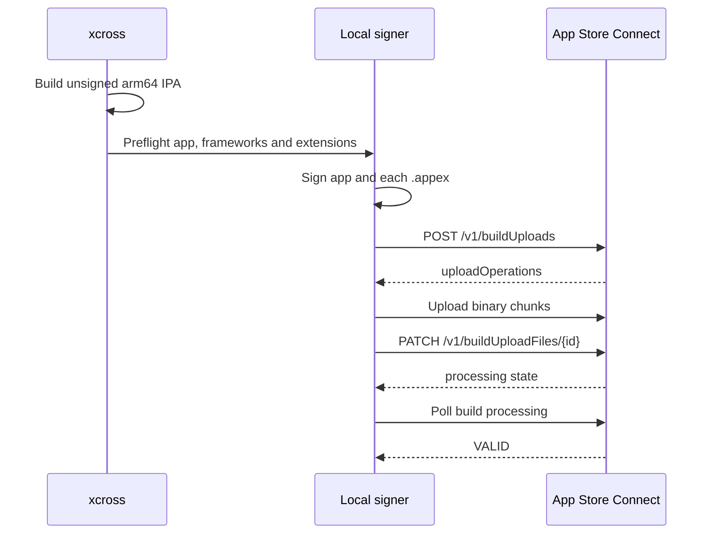

# Windows TestFlight handoff

This document describes the project-level handoff after xcross has produced an
unsigned IPA. It is a guide, not a place to store credentials. The project
must supply its own Bundle IDs, profiles, certificates and secret handling.

## Prerequisites

- Paid Apple Developer membership.
- App Store Connect API key with the required access.
- Apple Distribution certificate and private key.
- One provisioning profile for the main app.
- One provisioning profile for every embedded extension (`.appex`).
- Matching App IDs, App Groups and entitlements.
- A monotonically increasing `CFBundleVersion`.

Keep these outside Git:

```text
AuthKey_*.p8
private keys
*.p12 / *.pfx
*.mobileprovision
Xcode.xip
private Darwin SDK caches
```

## Recommended local layout

```text
project/
├─ tool/testflight.ps1       # project wrapper, no secrets
├─ build/xcross-ios/*.ipa    # generated and ignored
└─ .secrets/                 # local only, ignored
   ├─ AuthKey_<id>.p8
   ├─ distribution.pem
   ├─ distribution.key
   ├─ main.mobileprovision
   └─ widget.mobileprovision
```

The cross-platform executable is `xcross-testflight` (or
`dart run packages/xcross/bin/testflight.dart` from this repository). The
PowerShell wrapper remains useful when a project wants a Windows-native entry
point, but the Dart client is the preferred Windows/Linux implementation.

## Pipeline stages



## App Store Connect API flow

The wrapper should implement these steps:

1. Create a JWT with the App Store Connect issuer ID, key ID and local `.p8`.
2. Resolve the App Store Connect app ID from the Bundle ID, or accept it as a
   secret-free configuration value.
3. Check whether the same build number is already `VALID` or `PROCESSING`.
4. If it is already `VALID` or active, report/reuse it instead of creating a
   duplicate binary upload.
5. Otherwise call `POST /v1/buildUploads`.
6. Reserve the file using `POST /v1/buildUploadFiles`.
7. Upload every URL/range from `uploadOperations`.
8. Mark the file uploaded with `PATCH /v1/buildUploadFiles/{id}` and the MD5
   checksum Apple requires.
9. Poll the Build Upload and Build resources until `VALID`, failure or timeout.

The duplicate error below means the build number is already used; it is not an
indication that the IPA is malformed:

```text
ENTITY_ERROR.ATTRIBUTE.INVALID.DUPLICATE
The bundle version must be higher than the previously uploaded version.
```

For a genuinely new upload, increment `CFBundleVersion`, rebuild and repeat the
pipeline. Do not silently reuse a production build number.

The client also handles the race where two runners pass the initial check at
the same time: a `409` reservation response is re-read once and the existing
`AWAITING_UPLOAD` reservation is resumed. The local `.dart_tool` lock and the
workflow `concurrency` group cover the normal same-project case.

## Extension signing checklist

For every `PlugIns/*.appex`:

- [ ] Bundle ID has its own App ID.
- [ ] Provisioning profile matches that Bundle ID and Team ID.
- [ ] App Group and capabilities match the profile.
- [ ] The executable contains an arm64 device slice.
- [ ] The extension is signed after its nested frameworks/resources are final.
- [ ] The host app embeds the extension with the expected bundle identifier.

## Evidence for a successful handoff

```text
Preflight: missing LC_ENCRYPTION_INFO = 0
Preflight: plist mismatches = 0
Main app signature: PASS
Every extension signature: PASS
Upload commit: PASS
App Store Connect processing: VALID
```

`VALID` proves Apple accepted and processed the build. It does not replace a
real iPhone smoke test of camera, Firebase, MLKit, widgets or other native
features.
